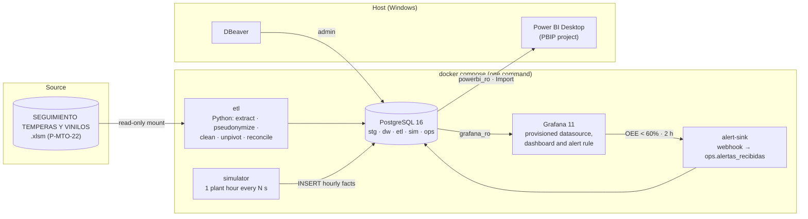

# BI de paros y productividad — Líneas de envasado de vinilos

End-to-end Business Intelligence solution for the four vinyl/tempera filling lines (Vinilos_1 … Vinilos_4). It turns the stoppage and production logbook (an Excel workbook with macros, procedure P-MTO-22) into a **PostgreSQL dimensional model** that feeds two consumption layers:

- **Power BI**: strategic analysis for the monthly management committee (OEE trends, Pareto of causes, drill-down of the stoppage hierarchy).
- **Grafana**: near-real-time monitoring for supervisors and maintenance (hourly OEE, current state per machine, alerts).

Course: Inteligencia de Negocios (ET0194) · Taller 5 · Institución Universitaria Pascual Bravo · 2026-2
Author: Brayan Romero Dorado

---

## Architecture



| Layer | Question it answers | User | Refresh |
|---|---|---|---|
| Grafana | "What is happening on the lines right now?" | Supervisor, maintenance | Every 10 s (one simulated hour every 30 s) |
| Power BI | "Why are we losing capacity and where should we invest?" | Management, maintenance coordinator, planning | Monthly / on demand |

---

## Repository layout

```
├── docker-compose.yml          # db, etl, simulator, alert-sink, grafana
├── .env.example                # copy to .env (git-ignored)
├── data/raw/                   # put the Excel here (git-ignored: personal data)
├── sql/
│   ├── init/                   # DDL executed automatically on an empty volume
│   │   ├── 01_schemas.sql … 06_views.sql
│   │   └── 99_roles.sh         # least-privilege users from env vars
│   ├── queries/                # analytical queries + reconciliation (DBeaver)
│   └── demo/                   # SCD2 demo and live simulator scenarios
├── etl/                        # Python ETL, simulator and alert sink (one image)
├── grafana/
│   ├── provisioning/           # datasource, dashboard provider, alert rule, contact point
│   ├── dashboards/operativo.json
│   └── build_dashboard.py      # generates the dashboard JSON
├── powerbi/                    # Power BI project in PBIP format (text, Git-friendly)
└── docs/                       # design, data dictionary, ETL and data quality
```

---

## Reproduce from scratch

Requirements: Docker Desktop, Git, Power BI Desktop and DBeaver (on the host).

```bash
git clone <repo-url> bi-paros-envasado
cd bi-paros-envasado
cp .env.example .env                       # edit every CHANGE_ME value
# copy the Excel into data/raw/ with the name set in SOURCE_FILE_NAME
docker compose up -d --build
docker compose logs -f etl                 # watch the load and the reconciliation
```

What happens:
1. `db` creates the schemas, tables, indexes, views and the three users (only the first time, on an empty volume).
2. `etl` loads the warehouse and exits with code 0. It prints the rule counts and the reconciliation.
3. `simulator` starts after the ETL finishes and writes one row per machine every `SIM_TICK_SECONDS`.
4. `grafana` starts already connected to PostgreSQL, with the dashboard and the alert rule loaded. There is nothing to configure by hand.

| Service | URL / connection |
|---|---|
| Grafana | http://localhost:3000 (user/password from `.env`) |
| PostgreSQL (DBeaver) | `localhost:${DB_PORT}` (5432 by default), database `bi_paros`, user `POSTGRES_USER` |
| PostgreSQL (Power BI) | `localhost:${DB_PORT}`, database `bi_paros`, user `powerbi_ro` |

Useful commands:

```bash
docker compose run --rm etl        # re-run only the ETL (full refresh)
docker compose down                # stop, keep data (volumes)
docker compose down -v             # stop and delete data → next "up" rebuilds everything
```

---

## Live demo (Grafana reacts to the simulator)

From DBeaver run `sql/demo/02_escenarios_simulador.sql`:

```sql
UPDATE sim.control SET modo = 'falla', actualizado = now() WHERE maquina_nk = 'Vinilos_2';
```

Within about a minute (two simulated hours), the OEE of Vinilos_2 turns red and the alert **"OEE por debajo de 60% durante 2 horas"** fires. The notification shows up in the panel *Alertas recibidas*. Run `modo = 'normal'` and the alert resolves.

Modes: `normal`, `falla` (code 01), `lenta` (code 05 | 5.2 dosing system), `parada` (code 14, no raw material).

---

## Data model (summary)

Kimball constellation with three facts and conformed dimensions. Full details: [docs/01-design.md](docs/01-design.md), [docs/02-data-dictionary.md](docs/02-data-dictionary.md).

| Fact | Grain |
|---|---|
| `dw.fact_produccion_turno` | one shift form: machine × date × shift × operator × reference |
| `dw.fact_paro` | one stoppage cause inside one source record (unpivot of 18 code columns) |
| `dw.fact_produccion_hora` | one machine × one simulated hour (near real time) |

Dimensions: `dim_fecha` (built by us, with Colombian holidays), `dim_turno`, `dim_maquina` (**SCD2**), `dim_referencia`, `dim_persona` (role-playing, pseudonymized), `dim_causa_paro` (hierarchy Área → Código → Sistema → Componente), `dim_estado_turno`.

OEE = Availability × Performance × Quality. The time model and the indicator catalog are in [docs/01-design.md §3](docs/01-design.md).

---

## Security and personal data

- **Ley 1581 de 2012.** Operator and maintenance staff names are replaced by `PER-xxxxxx` (salted SHA-256) **before** they are written to the database. The salt lives in `.env`.
- The Excel source is git-ignored. No password or connection string is versioned; `.env.example` holds only placeholders.
- **Least privilege:** `etl_user` (read/write), `grafana_ro` (read-only on `dw`, `sim`, `ops`) and `powerbi_ro` (read-only on `dw`). The admin user is only for DBeaver.
- Grafana: sign-up and anonymous access disabled; the admin password comes from `.env`.

---

## Documentation

| Document | Content |
|---|---|
| [01-design.md](docs/01-design.md) | Users, business questions, source diagnosis, KPI catalog, dimensional model, bus matrix, SCD |
| [02-data-dictionary.md](docs/02-data-dictionary.md) | Every table: columns, types, keys, transformation rules, lineage |
| [03-etl-and-data-quality.md](docs/03-etl-and-data-quality.md) | ETL design, cleaning rules with counts, reconciliation |
| [04-powerbi-guide.md](docs/04-powerbi-guide.md) | Power BI connection, relationships, DAX measures (`powerbi/medidas.dax`) and report pages |
